# Informe técnico: Plataforma de Donaciones Seguras AQP-SOLIDARIA

**Curso:** Tópicos Avanzados en Ingeniería de Software, EPIS, UNSA
**Equipo:** Chancuaña Alvis Klismann · Cuenca Gutiérrez José Luis · Hidalgo Chinchay Paulo André · Mamani Solórzano Efraín Alex · Soto Ccoya Gabriel Eduardo
**Periodo de trabajo:** del 10 al 13 de noviembre de 2026
**Repositorio:** https://github.com/JCuenca17/aqp-solidaria · **Demo:** https://d1mkuf1y3fbox2.cloudfront.net

## 1. Introducción y alcance

La Fundación AQP-SOLIDARIA (ficticia) necesita publicar campañas sociales y registrar intenciones de donación verificables y auditables. El prototipo implementa el MVP completo de `requirements.md`: HU-01 a HU-09, HU-11 y RNF-HU-01 a RNF-HU-11. También incluye la extensión HU-10 (consulta de auditoría). La extensión HU-12 (Verified Permissions) queda fuera de esta entrega; las reglas equivalentes en Cedar están en `policies/` como diseño.

Las donaciones son simuladas. El sistema no pide ni guarda tarjetas, CVV, cuentas ni DNI, y la interfaz muestra «Simulación académica: no se ha realizado ningún cobro».

## 2. Metodología

El equipo trabajó con desarrollo dirigido por especificación (SDD). `requirements.md` define qué construir y `design.md` cómo hacerlo; `tasks.md` es el plan de implementación, con el orden de las tareas y la forma de verificar cada una. El despliegue y las pruebas siguieron ese plan tarea por tarea. Cada historia y criterio (HU-xx, CA-xx.x, RNF-HU-xx) se puede rastrear hasta el código, una prueba automática y una prueba de aceptación (T01 a T14), y las pruebas unitarias llevan en su nombre el identificador del criterio que verifican.

| Fecha | Trabajo | Resultado verificable |
|---|---|---|
| 10/11 | Análisis de la especificación, roles, threat model | Plan y modelo de amenazas |
| 11/11 | Repositorio, backend, plantilla SAM, SPA, pruebas unitarias, CI | 77 pruebas en verde, `cfn-lint` sin errores |
| 11/11 | Cuenta Free plan (nueva experiencia de AWS), MFA, presupuesto, equipo, despliegue, usuarios de prueba y TOTP | WebUrl activa, capturas en `evidence/capturas/` |
| 11/11 | Pruebas T01 a T14, rendimiento y evidencias | `evidence/` |
| 12 y 13/11 | Revisión por PR, capturas pendientes, ensayo de la demo y entrega | Informe final |

Tabla: Cronograma de trabajo (del 10 al 13 de noviembre de 2026).

Los roles siguen la propuesta de design.md §9:

| Integrante | Rol | Responsabilidad principal |
|---|---|---|
| Cuenca Gutiérrez José Luis | Líder técnico y DevOps | Cuenta AWS Free plan, plantilla SAM, CI, despliegue desde CloudShell |
| Chancuaña Alvis Klismann | Identidad y seguridad | Cognito (PKCE, grupos, MFA TOTP), módulo `authz`, threat model y mapeo NIST |
| Hidalgo Chinchay Paulo André | Backend | Donaciones, idempotencia y transacciones en DynamoDB |
| Mamani Solórzano Efraín Alex | Frontend | SPA React, login OIDC, accesibilidad |
| Soto Ccoya Gabriel Eduardo | QA y documentación | Pruebas T01 a T14, evidencias e informe |

Tabla: Roles del equipo.

## 3. Arquitectura

La arquitectura es serverless y modular, en un solo repositorio (AD-02). La SPA React es estática y se sirve desde un bucket S3 privado a través de CloudFront con OAC. El API es una HTTP API de API Gateway con un JWT authorizer de Cognito, que invoca siete funciones Lambda en Node.js 24 (una por caso de uso) sobre cuatro tablas DynamoDB on-demand. Toda la infraestructura está descrita en `infra/template.yaml` (AWS SAM): se crea con `sam deploy` y se elimina con `sam delete`.

| Función Lambda | Rutas | Permisos DynamoDB |
|---|---|---|
| `public-projects` | `GET /v1/projects`, `/{id}`, `/{id}/stats` | Projects: `GetItem`, `Query` (solo lectura) |
| `manage-projects` | `POST /v1/projects`, `PATCH /{id}/publish`, `GET /v1/manage/projects` | Projects: Get/Put/Update/Query; Audit: `PutItem` |
| `create-donation` | `POST /v1/donations` | Projects: Get/ConditionCheck; Idempotency y Donations: Get/Put; Audit: Put |
| `simulate-donation` | `POST /v1/donations/{id}/simulate` (solo stage `academic`) | Donations: Get/Update; Projects: Update; Audit: Put |
| `read-donations` | `GET /v1/donations/me`, `/{id}` | Donations: Get, Query del GSI; Audit: Put |
| `audit-query` | `GET /v1/audit` | Audit: Query/Put |
| `pre-auth` | Trigger de Cognito | Cognito: `AdminGetUser`, `AdminListGroupsForUser` |

Tabla: Funciones Lambda, rutas y permisos sobre DynamoDB.

Los límites de confianza van del navegador, que no es confiable, a API Gateway, que verifica el JWT. De ahí la solicitud pasa a Lambda, que verifica rol, propietario y reglas de negocio, y por último a DynamoDB, donde cada función solo puede hacer lo que su política IAM permite.

### 3.1 Despliegue y hallazgos

El despliegue se hizo el 11/11 desde AWS CloudShell con `bash scripts/deploy.sh`, que compila el backend, ejecuta `sam deploy` (53 recursos), genera la configuración del frontend y publica la SPA en S3. Al ejecutarlo contra AWS aparecieron cinco problemas que ni las pruebas locales ni `cfn-lint` habían detectado. Todos se corrigieron y quedaron en el historial del repositorio:

1. La transformación SAM rechazó la plantilla porque las rutas públicas usaban `Authorizer: NONE` sin un `DefaultAuthorizer`. Se definió `CognitoJwt` como autorizador por defecto (deny by default) y las tres rutas públicas lo omiten de forma explícita.
2. El CORS no se aplicaba. Un `!If` sobre la lista `AllowOrigins` hizo que SAM generara una configuración CORS vacía, y el navegador bloqueaba las llamadas al API. Se reescribió la lista y se añadió al CI una validación con el traductor oficial de SAM (`scripts/validate-sam.py`).
3. T11 devolvió 403 en lugar de 401 para el ID token (ver §4.4).
4. T10 daba `explicitDeny` en todas las acciones al simular sin contexto, por las SCP que AWS administra en la cuenta. Se añadió `aws:RequestedRegion` al simulador.
5. La prueba de rendimiento recibió respuestas 429 por el throttling del stage (ver §6.3).

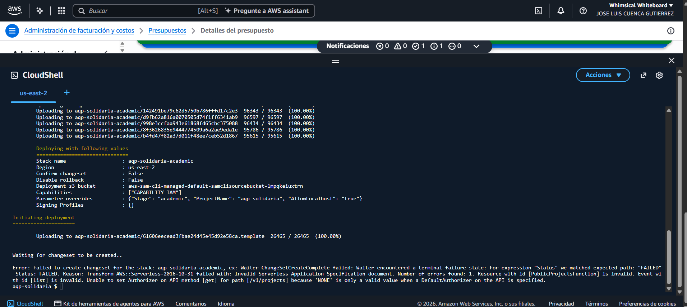

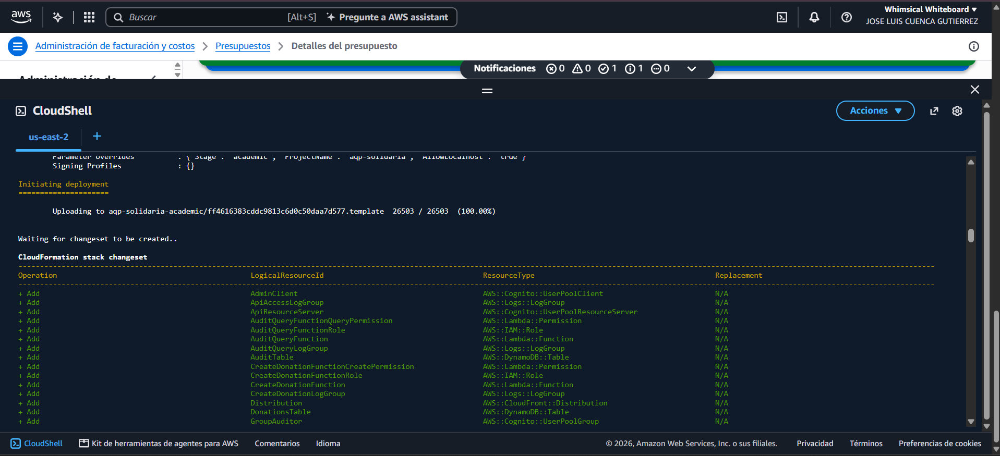

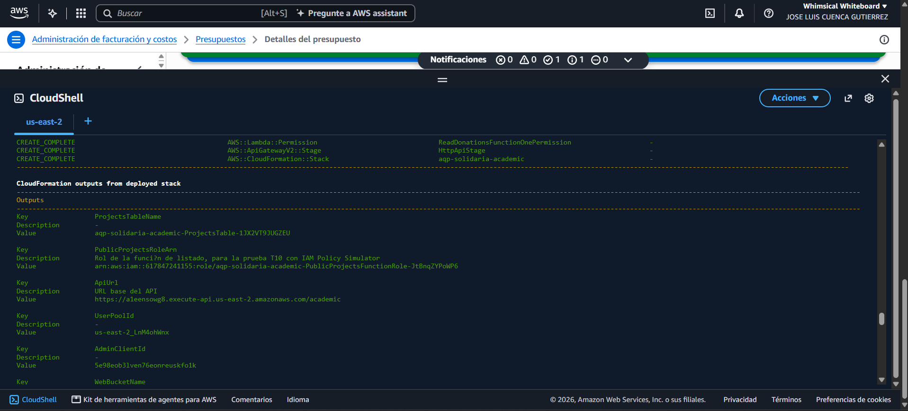

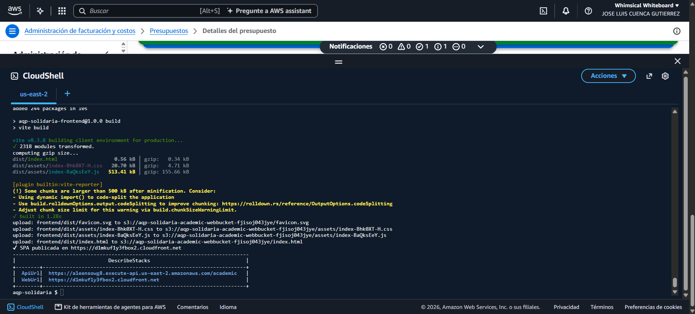

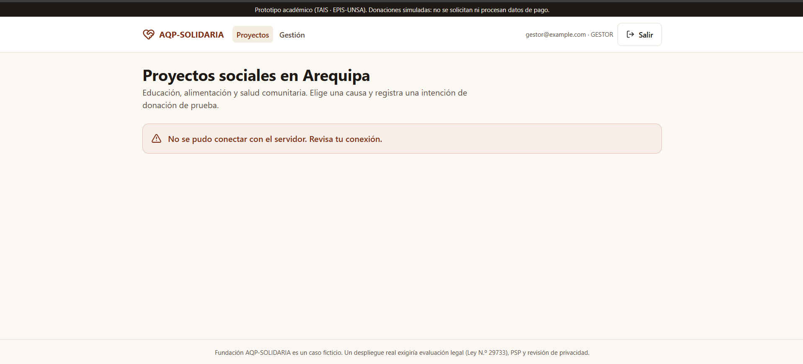

## 4. Seguridad Zero Trust

### 4.1 Componentes NIST SP 800-207

| Componente | Implementación |
|---|---|
| PEP | API Gateway HTTP API: JWT authorizer (emisor, firma, expiración, `client_id`) y `AuthorizationScopes` por ruta |
| PE | Módulo `backend/src/authz`: identidad solo desde claims verificados, matriz `POLICY` (grupo + scope) y ownership contra el recurso persistido |
| PA | Cognito: Authorization Code + PKCE, access token de 15 min, revocación del refresh token, MFA TOTP |
| Fuentes | Claims, estado en DynamoDB, CloudWatch Logs, CloudTrail |

Tabla: Componentes de NIST SP 800-207 en el sistema.

### 4.2 Mapeo a los 7 principios

| Principio | Control | Evidencia |
|---|---|---|
| 1. Todo es un recurso | Política explícita por endpoint y por tabla | `docs/api.yaml`, plantilla SAM |
| 2. Comunicación segura | HTTPS en CloudFront (redirect 301 + HSTS) y API Gateway; el bucket deniega tráfico sin TLS | Cabeceras verificadas el 11/11 (§7) |
| 3. Acceso por sesión y por recurso | Token de 15 min, scopes, ownership | T09, T11, T13 |
| 4. Política dinámica | Identidad + grupo + estado del recurso + stage en cada solicitud | T03, T12 |
| 5. Postura de activos | Parcial: CloudTrail, Dependabot y `npm audit`; sin postura de dispositivo | Limitación |
| 6. AuthN/AuthZ estrictas | JWT authorizer + `authz` + MFA para GESTOR/AUDITOR | T02, T11, T14 |
| 7. Recolectar información | Logs JSON con `requestId`, `AuditEvents` (incluye `ACCESS_DENIED`), CloudTrail | Access logs en CloudWatch (§8) |

Tabla: Mapeo de controles a los siete principios de NIST SP 800-207.

### 4.3 Decisiones relevantes

- El MFA es obligatorio solo para los roles privilegiados (HU-11). El user pool tiene MFA opcional para no imponerlo al donante, y un trigger *Pre authentication* rechaza a cualquier GESTOR o AUDITOR que no tenga TOTP configurado. A quien sí lo tiene, Cognito le pide el código y sin él no emite tokens (T14). No se usa SMS.

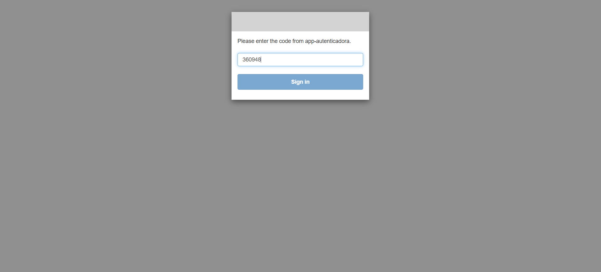

- Los tokens se guardan solo en memoria (CA-NF11.1), con `oidc-client-ts` e `InMemoryWebStorage`. El costo es que al recargar la página se pierde la sesión de la SPA, aunque se recupera sin contraseña mientras siga viva la sesión del managed login.
- El ID token no sirve para llamar al API: las rutas protegidas exigen scopes que solo trae el access token, y además `authz` exige `token_use = access`.
- Cognito otorga los mismos scopes a todos los usuarios del cliente, por lo que el grupo se valida siempre en Lambda. En T12, un GESTOR con el scope `api/donations.read` recibe 403.
- Un recurso ajeno responde 404 y no 403, para no revelar si la donación existe (BOLA).
- CloudFront entrega, mediante una response headers policy, una CSP restrictiva (`script-src 'self'`, `frame-ancestors 'none'` y `connect-src` limitado al API y a Cognito), además de HSTS, `nosniff` y `Referrer-Policy`.

### 4.4 Limitaciones declaradas

1. Un access token revocado sigue siendo válido hasta expirar (el JWT authorizer valida localmente). La ventana máxima es de 15 minutos (T13). La alternativa sería un Lambda authorizer con lista de revocación.
2. No hay postura de dispositivo, evaluación continua de riesgo, ZTNA (Verified Access) ni detección gestionada (GuardDuty, Security Hub), porque no están en el Free plan.
3. HTTP API no admite WAF directamente.
4. La cuenta es compartida. En la nueva experiencia de AWS, los integrantes invitados al equipo tienen acceso de administrador al proyecto y no se puede restringir por persona. El aislamiento depende de la disciplina del equipo (solo el líder técnico despliega) y la trazabilidad, de CloudTrail.
5. El ID token recibe 403 en lugar de 401 (T11). CA-03.2 espera 401 al usar un ID token. El ID token de Cognito tiene firma, emisor y `aud` válidos, así que el JWT authorizer lo acepta como JWT, pero lo rechaza por no tener los scopes de la ruta. Ese caso (`insufficient_scope`) se responde con 403, como define RFC 6750 §3.1, y el código no es configurable en HTTP API. El objetivo de CA-NF02.1 se cumple: el ID token no sirve como credencial y se rechaza en el PEP sin llegar a Lambda. El token alterado y el token basura sí devuelven 401. Obtener 401 exigiría sustituir el JWT authorizer por un Lambda authorizer, con más código y más superficie de ataque. La primera ejecución de las pruebas (`evidence/security-tests-2026-11-11T15-33-42-342Z.md`) registra este hallazgo.

## 5. Integridad, idempotencia y concurrencia

- El dinero se maneja en céntimos enteros: `amountCents` va de 100 a 100000. El frontend convierte soles a céntimos con una expresión regular, sin pasar por `float`.
- La idempotencia es atómica (AD-05). Un único `TransactWriteItems` crea el `IdempotencyRecord` (condición `attribute_not_exists(pk)`), crea la donación y verifica que el proyecto siga `PUBLICADO`. Si se repite la clave con la misma carga (mismo SHA-256), se devuelve la misma donación; si la carga es distinta, el API responde 409. Si dos solicitudes con la misma clave compiten, la perdedora relee el registro y responde como repetición.
- Cada donación cambia de estado una sola vez (RNF-HU-04). La simulación actualiza la donación con la condición `status = PENDIENTE_SIMULACION AND donorSub = :sub` y, en la misma transacción, suma el monto al proyecto. Si llegan varias confirmaciones a la vez, DynamoDB acepta solo una transacción. Si las transacciones se cancelan mutuamente (`TransactionConflict`), se reintenta hasta 4 veces releyendo el estado. Una donación rechazada no toca el acumulado.

Resultado de T08 contra AWS (11/11): 200×1, 409×9 y un único incremento de S/ 7.00 en el acumulado.

## 6. Pruebas

### 6.1 Automáticas (CI)

| Suite | Cantidad | Cubre |
|---|---|---|
| Backend: esquemas | 25 | CA-05.1 a CA-05.3, CA-05.5, CA-08.1, conversión de montos |
| Backend: authz | 22 | Matriz de permisos, ID token, ownership, seudonimización |
| Backend: handlers | 26 | T01, T03 a T09 y T12 con DynamoDB simulado; auditoría; reintento transaccional |
| Frontend | 4 | Sin datos de pago, aviso de simulación, accesibilidad del error, céntimos + Idempotency-Key |

Tabla: Pruebas automáticas ejecutadas en el CI.

### 6.2 Aceptación contra el stage `academic`

| ID | Escenario | Esperado | Obtenido | Evidencia |
|---|---|---|---|---|
| T01 | Visitante consulta proyectos | 200, sin borradores | 200, 50 proyectos, solo PUBLICADO | `evidence/security-tests-*.md` |
| T02 | Sin token intenta donar | 401 | 401 | ídem |
| T03 | Donante intenta crear proyecto | 403 | 403 | ídem |
| T04 | Montos 0 / 100001 / no entero | 400 | 400 en los 4 casos | ídem |
| T05 | Intención válida | 201 pendiente | 201, PENDIENTE_SIMULACION | ídem |
| T06 | Misma clave y carga | Mismo resultado | 201, mismo id, 1 registro | ídem |
| T07 | Misma clave, otra carga | 409 | 409 | ídem |
| T08 | 10 confirmaciones concurrentes | Un solo incremento | 200×1, 409×9, incremento único de S/ 7.00 | ídem |
| T09 | Donación ajena | 403/404 | GET 404, simulate 404, sin filtración | ídem |
| T10 | Lambda de listado intenta escribir | AccessDenied | Put/Update/Delete: implicitDeny; Get/Query: allowed (control) | `evidence/t10-iam-simulator.md` |
| T11 | ID token / token alterado | 401 (ID token: 403, ver §4.4) | ID token 403, alterado 401, basura 401 | `evidence/security-tests-*.md` |
| T12 | Gestor consulta historial ajeno | 403/404 | /me 403, por id 403 | ídem |
| T13 | Token revocado antes de expirar | Aceptado hasta expirar | 200 en 12 consultas tras «Salir» (entre 20:32 y 20:43 UTC); 401 a las 20:44:44, 7 s después de expirar | `evidence/t13-revocation.md` |
| T14 | GESTOR sin segundo factor | Sin tokens | Reto SOFTWARE_TOKEN_MFA, sin tokens; login web pide TOTP | `evidence/t14-mfa.md` + captura |

Tabla: Resultados de las pruebas de aceptación T01 a T14 contra el stage académico.

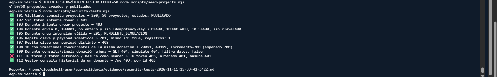

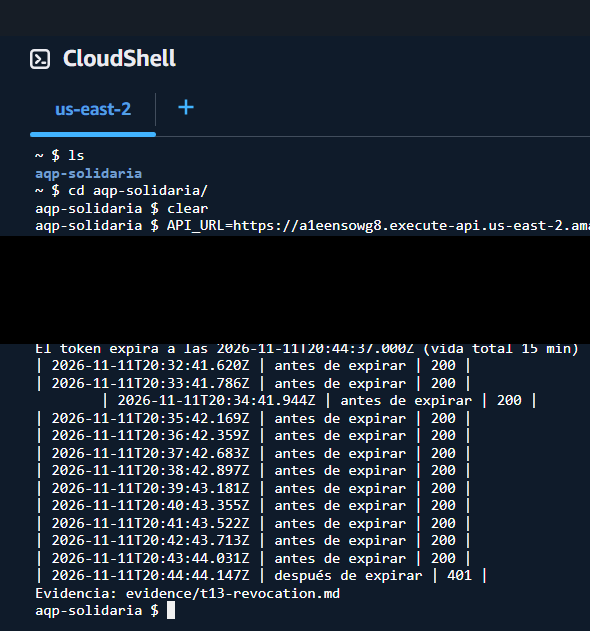

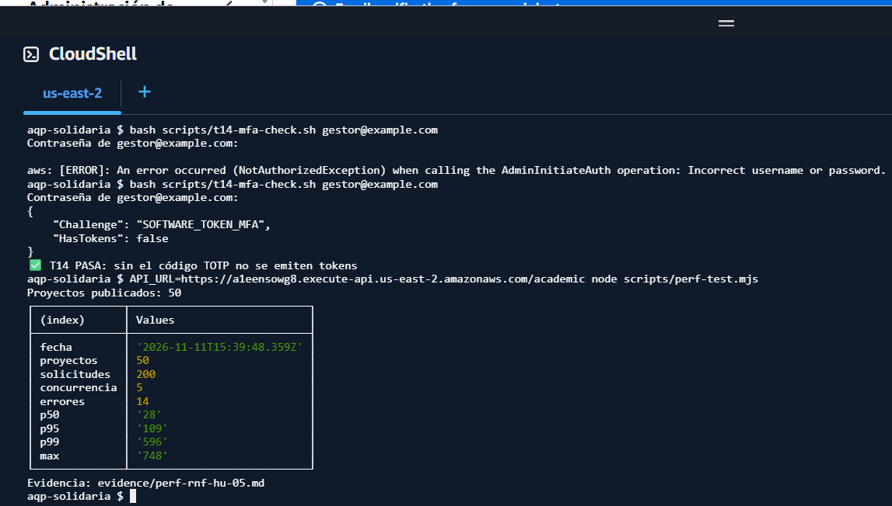

### 6.3 Rendimiento (RNF-HU-05)

Método: 50 proyectos publicados con `seed-projects.mjs`; `perf-test.mjs` desde CloudShell us-east-2 (misma región que el API), 5 solicitudes de calentamiento descartadas y 200 medidas a ritmo constante, mitad a `/v1/projects` y mitad a `/v1/projects/{id}`. Resultado final (11/11, 10 solicitudes/s): 200×200 respuestas, con p50 = 22 ms, p95 = 38 ms y p99 = 77 ms, dentro del criterio de 1500 ms para el p95. En corridas previas a más velocidad aparecieron respuestas 429: el throttling del stage está configurado en 25 rps / ráfaga 50 y el de la cuenta en 10 000 rps, así que no es una cuota de la cuenta. El límite de concurrencia de Lambda es 400, así que tampoco es Lambda. Los access logs del API muestran los 429 con `latencyMs: 0` e `integrationError: "-"`: los rechazó el throttling del stage antes de invocar Lambda. Ese límite no actuó como un corte exacto: a 20 rps (80 % del límite) ya rechazó algunas solicitudes y a 10 rps ninguna. Estas respuestas son también evidencia del control anti-abuso de design.md §6.2. Los percentiles se calculan solo con respuestas 200 y se reporta aparte cada código HTTP.

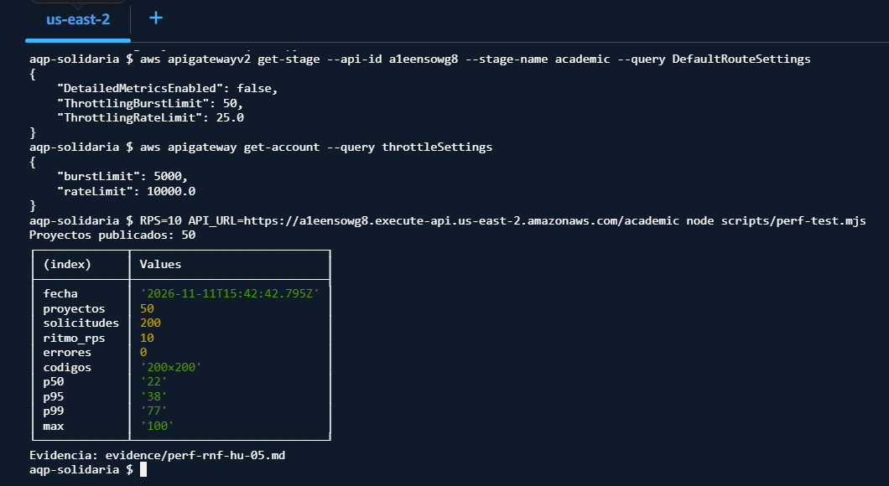

## 7. Experiencia de usuario y accesibilidad (RNF-HU-06)

Diseño responsive con Tailwind (sin Bootstrap), probado a 375 px. Criterios WCAG 2.2 AA aplicados:

- 1.3.1: etiquetas `<label>` asociadas y tablas con `<caption>` y `scope`.
- 2.4.1: enlace "Saltar al contenido".
- 2.4.7 y 2.4.11: foco visible de 3 px.
- 2.5.8: objetivos de al menos 44 px de alto.
- 3.3.1 y 4.1.3: errores con `role="alert"` y estados con `role="status"`.
- 1.4.3: contraste de texto principal sobre fondo claro.

Vistas capturadas en Chrome DevTools con el perfil iPhone SE (375 × 667 px, densidad 2x):

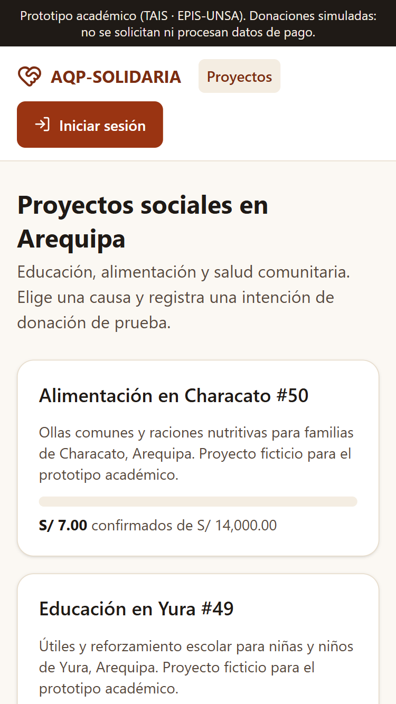 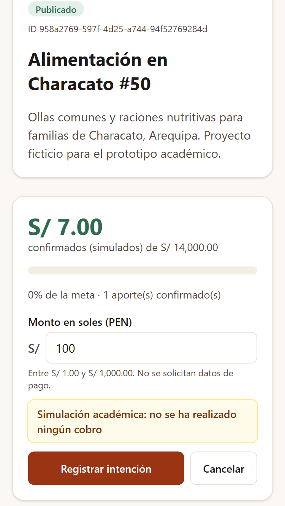 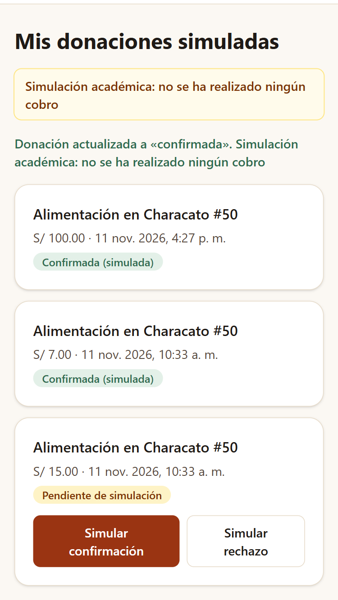

Las cabeceras de seguridad que entrega CloudFront se verificaron en el navegador (CA-NF11.2):

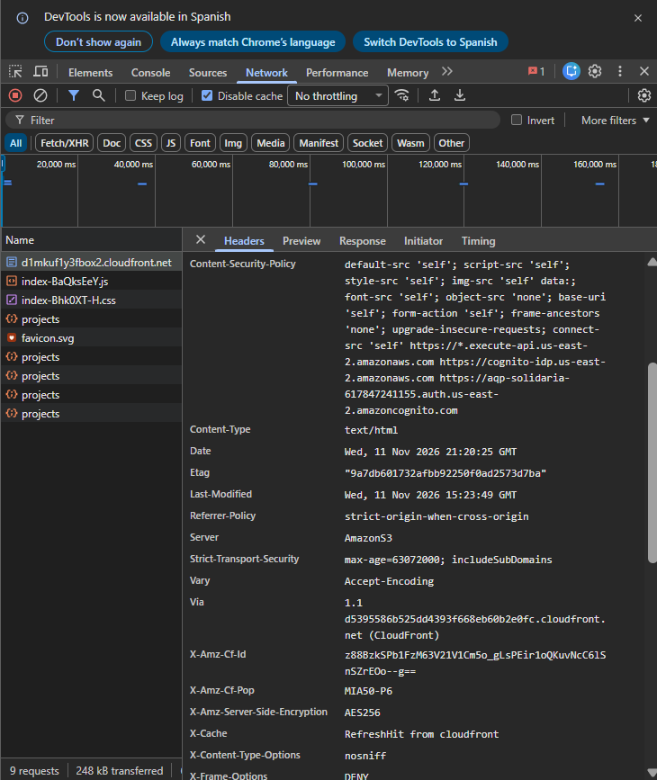

## 8. Observabilidad (RNF-HU-07)

Cada Lambda escribe una línea JSON por solicitud (`requestId`, acción, resultado, código HTTP, duración y actor seudonimizado) mediante un logger con lista blanca de campos. Los access logs del API no registran cabeceras, IP ni cuerpos. La retención de todos los grupos de logs es de 14 días. CloudTrail (historial de eventos) registra los cambios de infraestructura.

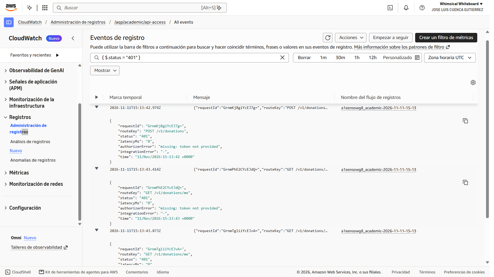

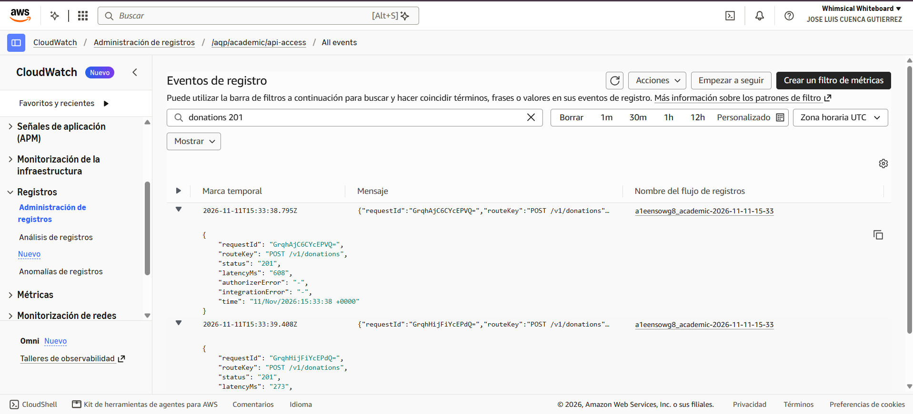

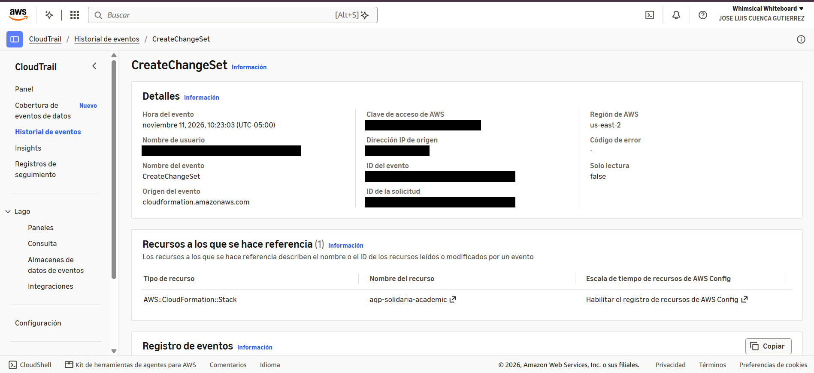

## 9. Costos, cuenta y limpieza (RNF-HU-09)

La cuenta AWS Free plan se creó con la nueva experiencia de AWS (proyectos y AWS Builder ID). Esa modalidad impone dos diferencias respecto al design.md. La primera es que AWS asigna la región según el país: para Perú es us-east-2 (Ohio), en lugar de la us-east-1 recomendada. La segunda es que no existe usuario root ni usuarios IAM de consola. La cuenta pertenece al Builder ID del dueño, protegido con MFA, y cada integrante entra como miembro del equipo con su propio Builder ID y MFA, lo que cumple por otro mecanismo el objetivo de CA-NF03.3 (identidad individual con MFA, sin root ni llaves de larga duración). La cuenta tiene una alerta de Budgets de gasto cero y el despliegue se hace desde CloudShell con credenciales temporales. Tras la evaluación se ejecuta `scripts/cleanup.sh` y se verifica en Resource Explorer que no queden recursos.

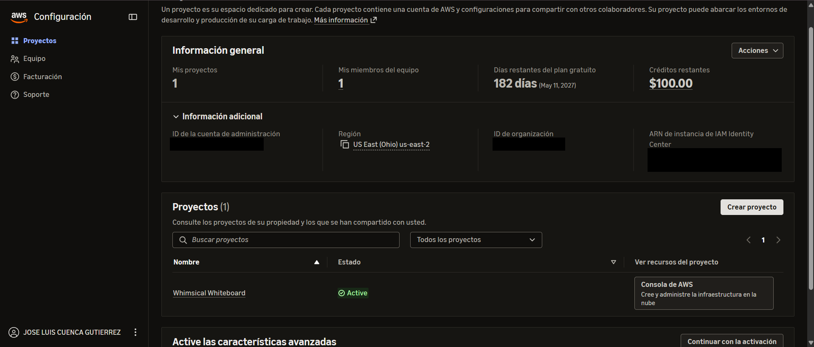

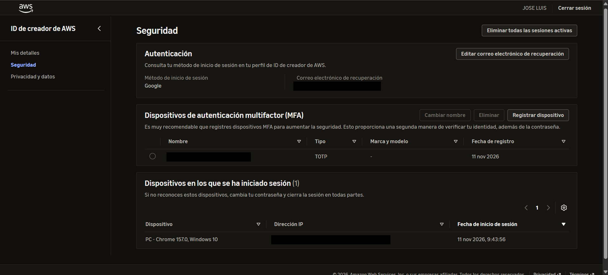

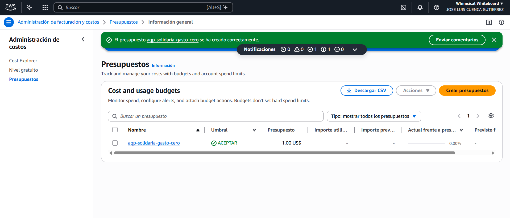

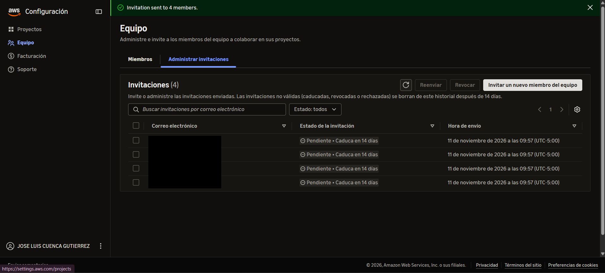

## 10. Uso de IA

Ver `AI_USAGE.md`. Se usó Claude Code (Claude Opus 5.5) para el scaffolding, el código, las pruebas y los borradores de documentación. El equipo desplegó, ejecutó las pruebas contra AWS y validó los resultados; esa ejecución reveló los cinco problemas de §3.1, que se corrigieron. Hasta el 11/11 los cambios se subieron directamente a `main` por el plazo de entrega. Desde ese día `main` está protegida y todo cambio entra por Pull Request con la aprobación de otro integrante y el CI en verde.

## 11. Conclusiones

1. Los controles Zero Trust se demostraron con pruebas negativas ejecutadas contra el sistema desplegado: las 14 pruebas de aceptación corrieron contra el stage `academic`. Las solicitudes sin token, con token alterado o con un ID token se rechazan en el PEP. Los roles sin permiso (T03, T12) y los recursos ajenos (T09) se rechazan en el PE. GESTOR y AUDITOR no obtienen tokens sin segundo factor (T14).
2. La integridad del dinero se mantiene bajo concurrencia real. Diez confirmaciones simultáneas de la misma donación produjeron un único incremento (T08). Las repeticiones con la misma clave no crearon duplicados (T06) y las claves reutilizadas con otra carga se rechazaron (T07).
3. El mínimo privilegio se puede verificar. Cada función tiene su propio rol, y el simulador de IAM confirma que la función de listado puede leer pero no escribir (T10).
4. El despliegue reveló problemas que el análisis estático no mostraba. `cfn-lint` aprobó una plantilla con dos defectos de la transformación SAM (autorizador y CORS) que solo aparecieron al desplegar. Por eso se añadió al CI la validación con el traductor oficial.
5. Quedan cuatro limitaciones: un token revocado vale hasta 15 minutos (T13), el Free plan no ofrece postura de dispositivo ni detección gestionada, el ID token se rechaza con 403 en lugar de 401 y los integrantes del equipo tienen acceso de administrador al proyecto.
6. Un despliegue real necesitaría un PSP con tokenización y webhooks firmados, un Lambda authorizer con lista de revocación, WAF delante de CloudFront o REST API, detección gestionada (GuardDuty, Security Hub) y una evaluación legal de protección de datos (Ley N.º 29733), tributaria y de prevención de fraude.

## Referencias

- NIST SP 800-207, *Zero Trust Architecture*. https://csrc.nist.gov/pubs/sp/800/207/final
- NIST SP 800-207A, *ZTA Model for Access Control in Cloud-Native Applications*. https://csrc.nist.gov/pubs/sp/800/207/a/final
- CISA, *Zero Trust Maturity Model v2.0*. https://www.cisa.gov/resources-tools/resources/zero-trust-maturity-model
- OWASP, *API Security Top 10*. https://owasp.org/API-Security/
- AWS, *Controlling access to HTTP APIs with JWT authorizers*. https://docs.aws.amazon.com/apigateway/latest/developerguide/http-api-jwt-authorizer.html
- AWS, *Revoking tokens* (Cognito). https://docs.aws.amazon.com/cognito/latest/developerguide/token-revocation.html
